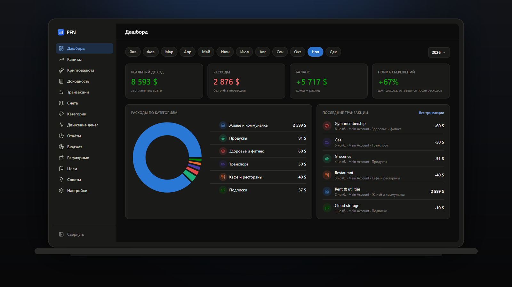
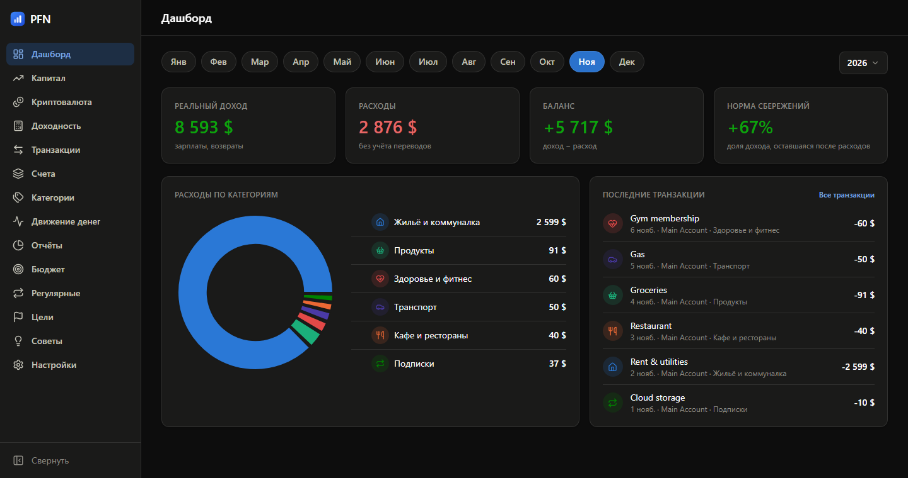
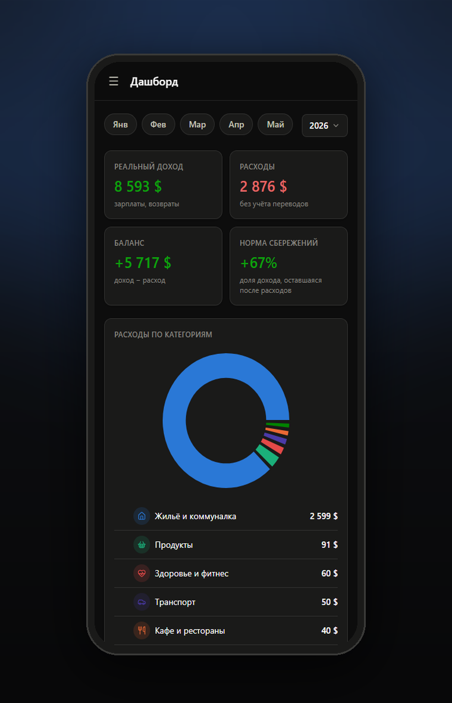

# PFN — Private Finance Tracker

**Все ваши деньги в одном окне.** Счета, доходы и расходы, капитал, бюджеты,
цели, регулярные платежи, активы и криптопортфель — в приложении, которое
работает на вашем компьютере. Данные лежат в одном файле и никуда не
отправляются.

[Скачать для Windows](https://github.com/0x-dorothy/PFN/releases) · [Исходный код](https://github.com/0x-dorothy/PFN) · [Как установить](install.md)

## Что это даёт

| | |
| --- | --- |
| **Без облака** | База — файл `pfn.db` в вашем профиле. Нет аккаунта, подписки и синхронизации «куда-то там». |
| **Без инфраструктуры** | Не нужны Docker, Postgres, nginx, Node.js. Один процесс, одна кнопка «Запустить». |
| **Без пересборки** | Скачали установщик — работает. Python и Node внутри, ставить ничего не надо. |
| **С бэкапом** | Весь набор данных выгружается в один JSON в любой момент и так же восстанавливается. |

## Как это выглядит

Экран отвечает на вопрос «сколько я реально заработал и куда ушло», а не
показывает одну круговую диаграмму за прошлый месяц: реальный доход, расходы,
баланс и норма сбережений, разбивка по категориям и последние операции.

## На телефоне

Интерфейс собран mobile-first: на узком экране карточки перестраиваются в одну
колонку, меню уезжает в шторку. Телефон открывает то же приложение по домашней
сети — данные остаются на вашем компьютере.

## Что внутри

- **Денежный поток** — доходы, расходы, переводы; категории с подкатегориями,
  теги, поиск, разделение одной покупки на несколько категорий.
- **Капитал** — график чистого капитала и разбивка по классам активов, риску и
  роли капитала.
- **Криптовалюта** — портфели, история покупок, средняя цена, P/L.
- **Бюджеты, цели, регулярные платежи** — лимиты по категориям, взносы в цели,
  проведение регулярных операций одной кнопкой.
- **Отчёты и советы** — рейтинг категорий за период и правила-подсказки.
- **Калькулятор доходности** — окупаемость и сложный процент с графиком.
- **Импорт CSV** — Т-Банк, monobank, ПриватБанк или своя схема колонок.

Подробнее — [Возможности](features.md).

## Дальше

- [Установка за две минуты](install.md)
- [Оформление: темы и акцентные цвета](appearance.md)
- [Где хранятся данные и как сделать бэкап](data.md)
