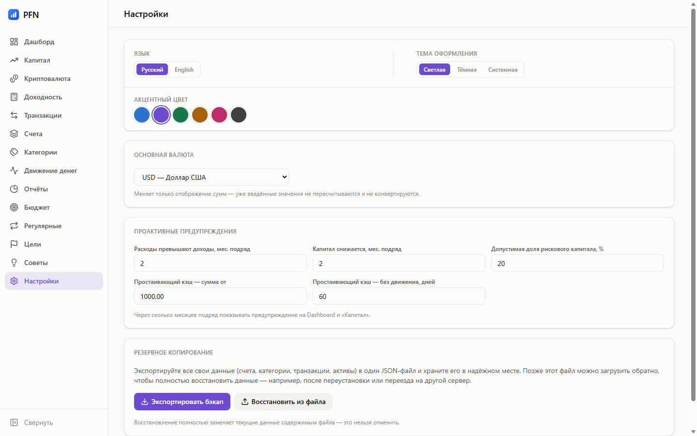

# Оформление

## Тема

Три режима: **светлая**, **тёмная** и **системная** — последняя следует за
настройкой ОС и переключается на лету, без перезагрузки.

Тему можно менять и в самой системе: приложение подхватит изменение, если
выбран системный режим.

## Акцентный цвет

Шесть пресетов: синий, фиолетовый, зелёный, янтарный, розовый, графит.
Акцент меняет кнопки, активный пункт меню, переключатели, фокус полей и ссылки.


Палитра графиков при этом не меняется. Эти восемь цветов подобраны под
цветовую слепоту, и «перекрасить» их вместе с кнопками значило бы сделать
отчёты нечитаемыми.


## Язык

Русский и английский, переключатель — там же, в настройках. Выбор запоминается
в браузере и применяется до первой отрисовки: вспышки «не той» темы или языка
при запуске нет.

## Где это хранится

Тема, акцент и язык — локальные настройки интерфейса, они живут в браузере
приложения. Валюта — серверная настройка: от неё зависит, в чём создаются новые
счёта и активы.
